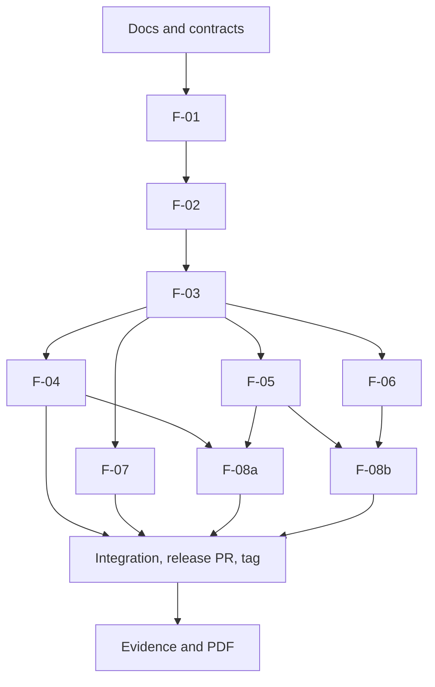

# Team Plan for AI Agents: Queue and Service Management System

Read this file first. It tells you what the project is, who owns what, the order of work, and the rules to follow. It is shared by two students (TauForge and MacOverlorD) and each uses their own AI agent. Do what your own human asks, inside these rules.

## 1. Project

- Course: CPE 334, Group Work, Theme 9 "Queue and Service Management System".
- Team: **TauForge** (Rattathamnoon Buranapattana, 67070501037) and **MacOverlorD** (Lappawat Laohasoot, 67070501039).
- Repo: https://github.com/TauForge/Queue_and_Service_Management_System_37-39
- Current deadline: **Project Deliverable 1, Sun 8 Nov 2026, 23:59.** One self-contained PDF (Parts A-F) on LEB2, plus a release tag on `main`. Target submitting by 20:00.
- Later: Lab 5 (CI/CD, Docker, GCP) due 15 Nov. Design now for containers, but do not build Docker or CI yet.
- Source specs (not in repo): `group_work_specs_v1.pdf` and `project_deliverable_1_v1.pdf`. Full plan: `docs/superpowers/plans/2026-11-05-deliverable-1-plan.md`.

## 2. What we build in Sprint 1

A real UI -> API -> PostgreSQL app with login, two roles, and a queue workflow. A static site or in-memory data does not count.

Flow: a seeded queue exists. A customer logs in, joins it, and sees their ticket number and status. An operator logs in, calls the next waiting entry, starts serving, and completes it. Invalid actions are rejected.

## 3. Agreed decisions (change only if both humans agree, then record it)

| ID | Decision |
|---|---|
| D-01 | Stack: React + TypeScript + Vite, Node + Express + TypeScript, Prisma, PostgreSQL. Tests: Vitest + Supertest, Playwright for 1-2 e2e journeys. |
| D-02 | Roles: Customer and Operator. Seeded accounts only. No self-registration. |
| D-03 | Order is first come first served by ticket number within a queue. |
| D-04 | One queue is one service. An operator may act only on queues assigned to them. |
| D-05 | A customer has at most one active entry (waiting, called, serving) per queue. |
| D-06 | States: `waiting -> called -> serving -> completed`. Every other transition is rejected in Sprint 1. Cancel and no-show are Sprint 2. |
| D-07 | "Call next" always takes the lowest waiting number. No calling a specific entry out of order. |
| D-08 | One `called` or `serving` entry per queue at a time. Multiple counters are Sprint 3. |
| D-09 | Ticket numbers are per queue, assigned atomically in a DB transaction, never reused. |
| D-10 | Auth: bcrypt hashes, server-side session in the DB, httpOnly cookie, 8 hour expiry, logout deletes the session. |
| D-11 | Public display endpoint returns only queue name, current serving number, waiting count. No names or customer IDs. |
| D-12 | Ticket numbering schema: `Queue.nextNumber` incremented atomically with `UPDATE ... RETURNING` inside the join transaction, plus `@@unique([queueId, number])` on `QueueEntry`. |
| D-13 | Duplicate active entry is blocked by the database: partial unique index `ON "QueueEntry"("queueId","customerId") WHERE status IN ('waiting','called','serving')`, written as raw SQL in the F-01 migration (Prisma schema cannot express it). A DB-level test must prove it. |
| D-14 | PR policy: each student may have at most one open PR at a time (so at most two open in total). PRs merge into staging in the planned order. Contracts for each student's features ship in their docs PR (#1, #2), merged by Fri 6 Nov morning. |

## 4. Features and ownership

Each feature has a GitHub Issue, a contract (feature SDS, AC, STS, DoD), tests and a PR.

| ID | Feature | Author | Reviewer |
|---|---|---|---|
| F-01 | Scaffold, DB schema, migrations, seed (queues, users, operator links, entries in every state) | TauForge | MacOverlorD |
| F-02 | Auth: login, logout, current user, hashing, session expiry | MacOverlorD | TauForge |
| F-03 | Role and queue-scope authorization middleware | TauForge | MacOverlorD |
| F-04 | Customer joins queue (atomic number, duplicate rejection) | MacOverlorD | TauForge |
| F-05 | Customer own-entry view, operator queue list | TauForge | MacOverlorD |
| F-06 | Operator call next, start, complete (transition rules) | MacOverlorD | TauForge |
| F-07 | Public display endpoint | TauForge | MacOverlorD |
| F-08a | UI: login, customer join and status | TauForge | MacOverlorD |
| F-08b | UI: operator console | MacOverlorD | TauForge |

Later sprints (do not build now): F-09 cancel and no-show, F-10 operator dashboard and multi-queue, F-11 public display screen, F-12 multiple counters and priority, F-13 summaries and reports.

Docs: TauForge writes `docs/srs.md`, `docs/features.md`, `docs/traceability.md`. MacOverlorD writes `docs/system-sds.md` and `docs/sprints/plan.md`. Each writes the contracts for their own features under `docs/sprints/sprint-1/`. Each reviews the other's.

No permanent roles. Both students must understand and be able to explain every requirement, test, design decision and release step.

## 5. Dependency graph and order

Merge order into `sprint1-staging`: docs, F-01, F-02, F-03, F-04, F-05, F-06, F-07, F-08a, F-08b. Features after F-03 can be written in parallel using seed data. **Each student keeps at most one open PR (D-14), and PRs merge in this order.**

## 6. Timeline

| When | TauForge | MacOverlorD |
|---|---|---|
| Thu 5 Nov evening | First commit on `main` (README, `.gitignore`, `.env.example`), create `sprint1-staging`, board, labels, Issues. Start SRS. | Accept invite, clone, test push. Start system SDS. |
| Fri 6 Nov morning | Finish SRS, features, traceability. Contracts for F-01, F-03, F-05, F-07, F-08a. Build F-01. | Finish system SDS, sprint plan. Contracts for F-02, F-04, F-06, F-08b. Failing tests for F-02 locally. Review Tau's docs. |
| Fri midday | F-01 PR | Review F-01 (merge F-01) |
| Fri afternoon | Review F-02, start F-03 | Build F-02 (merge F-02) |
| Fri evening | Build F-03 | Review F-03, start F-04 tests (merge F-03) |
| Fri evening to Sat morning | Build F-05 | Build F-04 with concurrency test (merge F-04, then F-05 after reviews) |
| Sat morning | Build F-07 | Build F-06 (merge F-06, then F-07 after reviews) |
| Sat midday to afternoon | Build F-08a | Build F-08b (merge F-08a, then F-08b) |
| Sat evening | Integration and e2e tests on staging together. Any failure goes through an Issue and a fix branch. | same |
| Sat night | Open release PR `sprint1-staging` -> `main` | Review, merge, tag `v0.1.0-sprint1` |
| Sun 8 Nov morning | Screenshots of journeys and rejections. Assemble PDF Parts A-C. | Test output and TDD evidence. Assemble PDF Parts D-F. |
| Sun afternoon | Both read the full PDF, fill the contribution table. Submit on LEB2 before 20:00. | same |

If time runs short, cut UI polish first. Never cut auth, role-enforcement tests, the rule-rejection tests, or the failing-then-passing TDD evidence.

## 7. Git workflow

Branches:
- `main`: released baseline. Only the reviewed release PR goes in.
- `sprint1-staging`: integration branch. All feature PRs target it.
- `feature/F-0X-name` or `fix/name`: one per feature, always cut from `sprint1-staging`.

Per feature:
1. Issue links the feature ID, FR/BR, and contract file.
2. Branch from `sprint1-staging`.
3. Commit 1: the failing test. Commit 2: the implementation that makes it pass. Update docs in the same PR.
4. Run tests, inspect your own diff, open a **draft PR** into `sprint1-staging` with `Closes #N`, using `.github/pull_request_template.md`. **Paste the failing test output (with commit ID) and the passing test output (with commit ID) in the PR.** This is the TDD evidence for the PDF.
5. Mark ready and request the other student. The reviewer leaves a specific check, question, finding or reason for approval.
6. The author fixes review points test-first. The reviewer approves. **Authors never approve their own PR.**
7. Merge in the planned order. Each student keeps at most one open PR at a time (D-14).

Release: after all features merge, run integration and system tests on staging, open a release PR to `main`, merge after review, tag `v0.1.0-sprint1`, and save test output tied to that commit. Do not change `main` after the tag.

Rules:
- Commit messages use `type: description` (feat, fix, test, docs, chore).
- Commits and PRs are authored under the human's own GitHub account. Do not add Co-Authored-By or "Generated with" lines.
- No force pushes. No real secrets in Git. Use synthetic data.
- Do not merge or close Issues by hand unless your human tells you to. Issues close through `Closes #N`.
- Ask your human before any push, PR creation, or marking a PR ready.
- Contracts are committed before the code they describe.

## 8. Engineering rules

- Use TDD: write the failing test first and keep evidence that it failed, then passed. Never weaken a test to make it pass.
- Enforce roles and ownership on the **backend**. A hidden button is not authorization.
- Hash passwords. Never log or return password hashes or private entries.
- Cover negative and boundary cases: invalid login, unauthenticated request, customer calling or completing, operator on an unassigned queue, customer reading another's entry, duplicate join, concurrent joins, invalid or out-of-order transition.
- Tests must be real: no stubs, no mock-only persistence checks. Report failed or skipped tests honestly.
- Keep files small and focused. Handle errors explicitly. Validate input at the API boundary.
- Document env vars in `.env.example`. Keep the README setup current and working from a clean clone.

## 9. Evidence to collect while working (needed for the PDF)

- Commit IDs and dates showing contract first, then failing test, then implementation.
- Two completed Issue + PR pairs with branch names, author, reviewer, a substantive review comment, and merge into staging and `main`.
- Screenshots: full journey with saved retrieval, a business-rule rejection, login/logout plus a forbidden role operation.
- Test command, tested commit, counts of passed/failed/skipped, and an AC-to-test results table.
- Two short test excerpts: one domain rule, one role restriction.
- Contribution table for both students and a short AI-use declaration (tools used and tasks assisted).

## 10. Definition of Done for Deliverable 1

- F-01 to F-08 merged through reviewed PRs into staging, then to `main`, tagged.
- Tests pass at the tagged commit and the output is saved.
- README works from a clean clone.
- PDF has Parts A-F, a table of contents, and a navigation table, with gaps disclosed.
- No real secrets in Git or the PDF.
