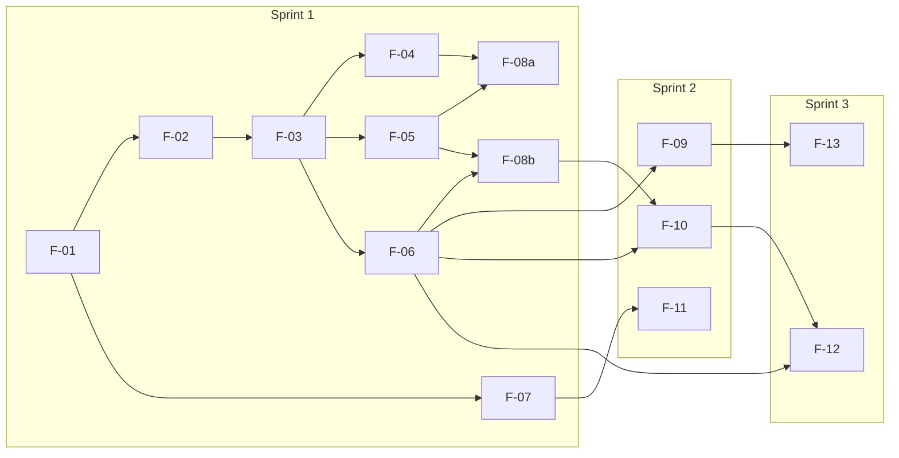

# Three-Sprint Plan

Queue and Service Management System, CPE 334 Theme 9.
Author: MacOverlorD (Lappawat Laohasoot). Reviewer: TauForge (Rattathamnoon Buranapattana).
Version: 0.1 (draft for Deliverable 1, 5 Nov 2026). Feature IDs follow `docs/features.md`; requirement mapping is in `docs/traceability.md`.

## 1. Overview

| Sprint | Goal | Features | Checkpoint |
|---|---|---|---|
| 1 | Small working queue slice with authentication, permissions and persistence | F-01 to F-08 | Deliverable 1, Sun 8 Nov (release `v0.1.0-sprint1`) |
| 2 | Complete the core queue lifecycle and operator tooling | F-09, F-10, F-11 | Deliverable 2, Sun 29 Nov (all Sprint 2 complete) |
| 3 | Multiple counters, priority, summaries, hardening | F-12, F-13, hardening | Progress at 29 Nov, complete by Sun 13 Dec |

Together the three sprints cover the whole product baseline: joining, calling, serving, completing, cancelling and no-shows, with useful service summaries (stakeholder brief, Theme 9).

## 2. Sprint 1: small deployable product (6 Nov to 8 Nov)

**Goal:** a customer joins a seeded queue and sees their ticket; an operator of that queue calls, serves and completes it. Invalid actions are rejected on the backend and covered by automated tests.

| Order | Feature | Depends on | Author / Reviewer | Completion outcome |
|---|---|---|---|---|
| 0 | Docs and contracts (Issues #1, #2) | none | both | SRS, features, traceability, system SDS, this plan and all Sprint 1 contracts merged into `sprint1-staging` by Fri 6 Nov morning |
| 1 | F-01 Scaffold, schema, migrations, seed | docs | TauForge / MacOverlorD | App and test DB start from a clean clone; D-12/D-13 constraints exist and a DB-level test proves D-13 |
| 2 | F-02 Authentication | F-01 | MacOverlorD / TauForge | Login, logout, `GET /api/auth/me`, 8 h DB sessions, tests for valid/invalid login and expired session |
| 3 | F-03 Authorization middleware | F-02 | TauForge / MacOverlorD | `requireRole` and `requireQueueOperator` with 401/403 tests |
| 4 | F-04 Customer joins queue | F-03 | MacOverlorD / TauForge | Atomic ticket number, duplicate active entry rejected (409), concurrent-join test |
| 5 | F-05 Own entry view, operator queue list | F-03 | TauForge / MacOverlorD | Customer reads only own entry (others 404); operator lists only assigned queues |
| 6 | F-06 Call next, start, complete | F-03 | MacOverlorD / TauForge | Head-of-line call, single active entry per queue, invalid transitions rejected (409), history events written |
| 7 | F-07 Public display endpoint | F-01 | TauForge / MacOverlorD | Returns queue name, now serving, waiting count; no private data |
| 8 | F-08a UI login, customer join and status | F-04, F-05 | TauForge / MacOverlorD | Customer journey in the browser |
| 9 | F-08b UI operator console | F-05, F-06 | MacOverlorD / TauForge | Operator journey in the browser |
| 10 | Integration, release PR, tag | all above | both | e2e journeys pass on staging; reviewed release PR merged to `main`; tag `v0.1.0-sprint1`; test output saved for that commit |

**Why this scope is feasible in three days:**
- Only two roles with seeded accounts; no registration, password reset or admin screens.
- One queue = one service and one counter (D-04, D-08), so there is no counter assignment logic yet.
- Four states with a fixed forward path (D-06); cancel and no-show wait for Sprint 2.
- Polling instead of real-time push; no external services.
- Features after F-03 can be written in parallel against seed data, so the two students are not blocked on each other. Each student keeps at most one open PR (D-14).

**Cut order if time runs short:** UI polish first, then F-07 (not required by the Theme 9 Sprint 1 example), then reduce F-08 to the three minimal screens. A cut is recorded, not silent: if F-07 is cut, FR-12 (API part), BR-08 and TEST-F07-01..03 are marked "Deferred" with the reason in `docs/traceability.md` in the same PR, and the cut is listed under known limitations in Part F. Never cut auth, role-enforcement tests, the business-rule rejection tests, or the failing-then-passing TDD evidence.

**Labs that build on this release:** Lab 5 (Docker, CI/CD, GCP, due 15 Nov) packages `v0.1.0-sprint1`. Lab 6 (cross-team UAT, due 22 Nov) tests a recorded release. Lab work is tracked in its own Issues and kept apart from feature work.

## 3. Sprint 2: core expansion (9 Nov to 29 Nov)

**Goal:** finish the queue lifecycle and give operators the tools to run a real counter. All Sprint 2 features must be complete at Deliverable 2.

| Feature | Depends on | Completion outcome |
|---|---|---|
| F-09 Cancel and no-show (FR-13, FR-14, BR-12, BR-13) | F-06 (transition rules) | Transitions `WAITING -> CANCELLED` and `CALLED -> NO_SHOW`; customer cancels only own waiting entry; operator marks a called entry as no-show, which frees the counter (removes the Sprint 1 stall); history events recorded |
| F-10 Queue control and multi-queue console (FR-15, FR-16, BR-10) | F-06, F-08b | Operator opens and closes assigned queues; one console covering all assigned queues with waiting count and current entry each |
| F-11 Public display screen (FR-17, BR-08) | F-07 | Auto-refreshing read-only page built on the F-07 API |

Each feature gets a contract before implementation, test-first work, and a reviewed PR into a `sprint2-staging` branch, then a reviewed release PR to `main`.

## 4. Sprint 3: completion and hardening (30 Nov to 13 Dec)

**Goal:** finish the remaining product features and harden the release for final delivery.

| Feature or work | Depends on | Completion outcome |
|---|---|---|
| F-12 Counters and priority (FR-18, FR-19, BR-05 revised, BR-14) | F-06, F-10 | Several counters serve one queue at the same time (BR-05 becomes per counter); priority policy agreed with the TA and tested |
| F-13 Service summaries (FR-20, NFR-10) | F-09 (uses `EntryEvent` history) | Per queue and day: served, cancelled and no-show counts and average waiting time |
| Hardening (R-QA, NFR-11) | all | Failure handling and error states, authorization regression tests, 80% server coverage, defect fixes from Lab 6 UAT, Lab 7 maintenance change, final traceability and DoD |

At 29 Nov the Sprint 3 contracts, working progress and an explicit remaining-work list are reported in Deliverable 2. Final release, report and demo video are due 13 Dec.

## 5. Dependencies across sprints

## 6. Risks

| Risk | Effect | Response |
|---|---|---|
| F-01 or F-02 slips past Fri midday | Every later feature slips | Write F-02 failing tests against the agreed schema before F-01 merges; cut F-07 first |
| Review round trips are slow | PRs wait for merge | Agree a review turnaround of a few hours; one open PR per student (D-14) |
| Concurrency bugs in join or call next | Duplicate numbers or two active entries | Database constraints (D-12, D-13) plus a concurrent-request test |
| Prisma drops the raw-SQL partial index in a later migration | BR-01 silently stops being enforced | Check every migration file; the DB-level test fails if the index is missing |
| Playwright setup takes too long | No e2e evidence | Keep at least one real e2e journey; document any manual check as a supplement only |
| Called customer never arrives (no no-show until Sprint 2) | Queue stalls in Sprint 1 | Recorded as a known limitation; fixed by F-09 |

## 7. Revision history

| Version | Date | Author | Change |
|---|---|---|---|
| 0.1 | 2026-11-05 | MacOverlorD | First draft |
| 0.2 | 2026-11-05 | MacOverlorD | Tau's review on #16: middleware name `requireQueueOperator`; a cut feature is recorded as Deferred in traceability |
