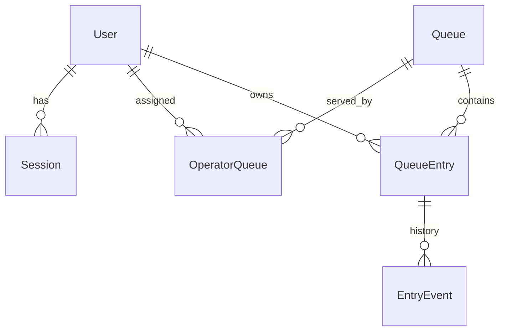
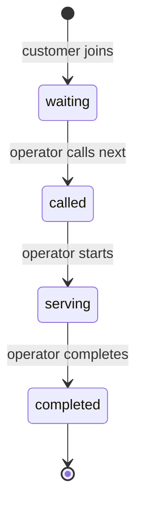
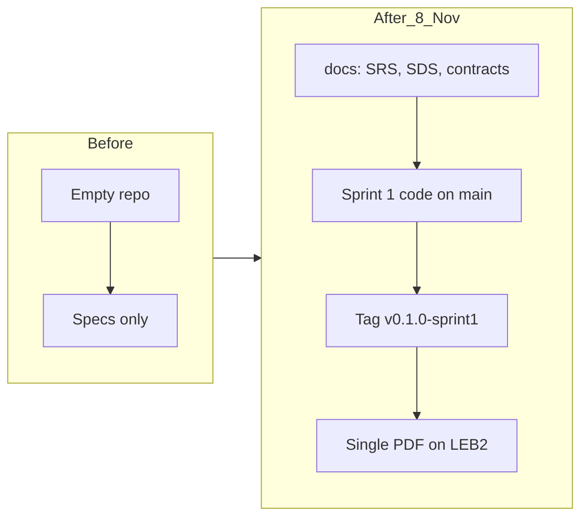

# Deliverable 1 Plan: Queue and Service Management System (Theme 9)

Team: TauForge (Rattathamnoon Buranapattana, 67070501037) and MacOverlorD (Lappawat Laohasoot, 67070501039).
Due: Sun 8 Nov 2026, 23:59, one self-contained PDF on LEB2 (Parts A-F), plus a release tag on `main`.
Sources: `group_work_specs_v1.pdf` (master spec) and `project_deliverable_1_v1.pdf` (handout).

## 1. Decisions (defaults, either of us can overturn before the SRS is committed)

| ID | Decision |
|---|---|
| D-01 | Stack: React + TypeScript + Vite, Node + Express + TypeScript, Prisma, PostgreSQL (same as TokTickIT). Vitest + Supertest for unit/API tests, Playwright for 1-2 end-to-end journeys. |
| D-02 | Roles: Customer, Operator. Seeded accounts only, no self-registration. |
| D-03 | Queue order is first come first served by ticket number within one queue. |
| D-04 | One queue = one service. An operator may act only on queues assigned to them (OperatorQueue link). |
| D-05 | A customer may hold at most one active entry (waiting, called, serving) per queue. |
| D-06 | Entry states: `waiting -> called -> serving -> completed`. Sprint 1 rejects every other transition. Cancel and no-show are Sprint 2. |
| D-07 | "Call next" always takes the lowest waiting number in that queue. An operator cannot call a specific entry out of order. |
| D-08 | A queue may have only one entry in `called` or `serving` at a time (single counter). Multiple counters are Sprint 3. |
| D-09 | Ticket numbers are per queue, assigned atomically in a database transaction (counter row on the queue, incremented with row lock). Numbers are never reused. |
| D-10 | Auth: bcrypt password hashes, server-side session stored in the DB, httpOnly cookie, 8 hour expiry, logout deletes the session. |
| D-11 | Public display endpoint returns only queue name, current serving number, and waiting count. No names or customer IDs. The display screen itself is Sprint 2. |

## 2. Product baseline (whole product, Parts A-D)

Scope across sprints:
- Sprint 1: auth, roles, queue join, own-entry view, call next, start serving, complete, public display endpoint.
- Sprint 2: customer cancel, no-show handling, multiple queues per operator, operator dashboard, public display screen.
- Sprint 3: multiple counters, priority policy, service summaries/reports, hardening and regression tests.

Feature inventory (IDs used in docs, Issues and tests):

| ID | Feature | Sprint |
|---|---|---|
| F-01 | Project scaffold, DB schema, migrations, reproducible seed | 1 |
| F-02 | Authentication: login, logout, current user, hashing, session expiry | 1 |
| F-03 | Role and queue-scope authorization middleware (backend) | 1 |
| F-04 | Customer joins queue (atomic number, duplicate rejection) | 1 |
| F-05 | Customer views own entry and status; operator views queue list | 1 |
| F-06 | Operator calls next, starts serving, completes (transition rules) | 1 |
| F-07 | Public queue display endpoint (limited, non-private) | 1 |
| F-08 | UI shell and screens: login, join/status, operator console | 1 |
| F-09 | Customer cancel, no-show | 2 |
| F-10 | Operator dashboard and multi-queue assignment | 2 |
| F-11 | Public display screen | 2 |
| F-12 | Multiple counters, priority policy | 3 |
| F-13 | Summaries and reports | 3 |

Requirement set (FR/BR/NFR written in `docs/srs.md`, each mapped to a feature, sprint, AC and TEST in `docs/traceability.md`). Sprint 1 business rules to state explicitly:
- BR-01 no second active entry per customer per queue.
- BR-02 ticket numbers are unique per queue even under concurrent joins.
- BR-03 only the head of the waiting line can be called.
- BR-04 only allowed transitions are accepted.
- BR-05 operators act only on assigned queues.
- BR-06 customers see only their own entry.
- BR-07 public display exposes no private data.
- NFR examples: unauthenticated request to a protected endpoint is rejected with no private data (API test); passwords never stored in plaintext (DB test); 50 concurrent joins produce 50 distinct numbers (integration test).

## 3. Data model (for `docs/system-sds.md`)

- `User(id, name, email unique, passwordHash, role)`
- `Session(id, userId, expiresAt)`
- `Queue(id, name, serviceName, nextNumber, isOpen)`
- `OperatorQueue(userId, queueId)` composite key
- `QueueEntry(id, queueId, customerId, number, status, createdAt, calledAt, servingAt, completedAt, handledByOperatorId)`
  - unique `(queueId, number)`
  - partial unique index on `(queueId, customerId)` where status in (waiting, called, serving)
- `EntryEvent(id, entryId, fromStatus, toStatus, actorId, at)` gives the history trail

## 4. Before / after picture

## 5. Role/permission matrix (draft for system SDS)

| Operation | Anonymous | Customer | Operator (assigned) | Operator (other queue) |
|---|---|---|---|---|
| Login / logout | login only | yes | yes | yes |
| Public display | yes | yes | yes | yes |
| Join queue | no | yes | no | no |
| View own entry | no | own only | no | no |
| View queue list | no | no | yes | no |
| Call / start / complete | no | no (403) | yes | no (403) |

## 6. Schedule

| When | Work | Owner split |
|---|---|---|
| Thu 5 Nov evening | Step 0: first commit (README, .gitignore, `.env.example`), create `sprint1-staging`, labels, project board, Issues F-01..F-08. Draft SRS. | Together |
| Fri 6 Nov morning | Finish SRS, features, traceability, sprint plan, system SDS. | Tau: SRS + features + traceability. Mac: system SDS + sprint plan. Swap review. |
| Fri 6 Nov midday | Sprint 1 contracts (feature SDS, AC, STS, DoD) for F-01..F-08, committed before code. | Odd features Tau, even Mac, each reviews the other's. |
| Fri 6 Nov afternoon to Sat 7 Nov | Implement test-first, one branch per feature off `sprint1-staging`, one PR at a time, cross-reviewed. | See section 7. |
| Sat 7 Nov evening | Integration, system tests and e2e on staging. Release PR staging to `main`. Tag `v0.1.0-sprint1`. Record test output at that commit. | Together |
| Sun 8 Nov | Screenshots, evidence, contribution table, AI-use declaration, README check, build PDF, both read it, submit before 20:00 (buffer to 23:59). | Together |

## 7. Implementation split (pair work, no permanent roles)

Order is dependency-driven. Author writes the failing test first, then the code. The other person reviews with a specific finding or reason for approval. Authors never approve their own PR.

| Order | Feature | Author | Reviewer |
|---|---|---|---|
| 1 | F-01 scaffold, schema, seed | Tau | Mac |
| 2 | F-02 auth | Mac | Tau |
| 3 | F-03 authorization middleware | Tau | Mac |
| 4 | F-04 join queue | Mac | Tau |
| 5 | F-05 own entry and operator list | Tau | Mac |
| 6 | F-06 call, start, complete | Mac | Tau |
| 7 | F-07 public display endpoint | Tau | Mac |
| 8 | F-08 UI screens | Together (pair) | each other |

Workflow per feature: Issue (links FR/BR, feature ID, contract) -> branch `feature/F-0X-name` from `sprint1-staging` -> failing test commit -> implementation commit -> PR (draft first) into staging -> review -> merge. Claude never merges, never closes Issues by hand (`Closes #N` only), never adds Co-Authored-By lines, and opens PRs one at a time per the standing PR rules.

## 8. Test plan (what Part F must show)

- Unit: transition table, next-number logic, head-of-line selection.
- API/DB integration: valid and invalid login, unauthenticated 401, customer calling/completing 403, operator on unassigned queue 403, customer reading another customer's entry 403/404, duplicate join rejected, 50 concurrent joins give distinct numbers, out-of-order transition rejected, data survives restart (reseed-free reload).
- E2E (Playwright): journey 1 customer joins and sees number; journey 2 operator calls and completes; customer then sees completed.
- TDD evidence: keep a commit where the BR-01/BR-03/BR-04 test fails, then the fixing commit; record both commit IDs.
- Results table maps every Sprint 1 AC to TEST ID, test file/name, result, tested commit.

## 9. PDF assembly (Part A-F, per handout section 4)

Order: cover (names, IDs, theme, repo URL, release tag/commit), table of contents, navigation table (page ranges), Parts A to F. Part F holds: three labeled screenshot scenarios (journey + saved retrieval, rule rejection, login/logout + forbidden operation), build/test commands with counts, AC-to-test table, two test excerpts (domain rule, role restriction) with TDD before/after, two Issue+PR examples with real review comments, history sequence with commit IDs, contribution table, AI-use declaration, known gaps, setup summary. Built with python-docx and LibreOffice to PDF, Times New Roman, black and white, no em dashes, real screenshots only.

## 10. Risks and cuts if time runs short

- Risk: UI takes longer than API. Cut F-08 to three minimal screens, API tests carry the evidence.
- Risk: review round trips with Mac cost time. Agree review turnaround of a few hours.
- Risk: Playwright setup. Fall back to documented manual UI checks plus API tests (handout allows manual checks as a supplement, so keep at least one real e2e if possible).
- Never cut: auth, role enforcement tests, the three rule rejections, evidence of failing-then-passing tests.

## 11. Definition of Done for Deliverable 1

- All F-01..F-08 merged via reviewed PRs into staging, release PR merged to `main`, tag created.
- `npm test` passes at the tagged commit with output saved.
- README setup works from a clean clone.
- Contracts committed before the code they describe.
- PDF contains Parts A-F, navigation table, evidence, and discloses any gap.
- No real secrets in Git or the PDF.
