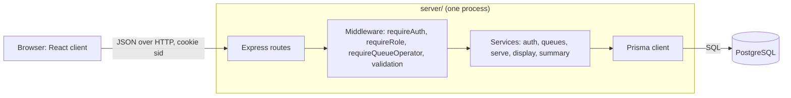
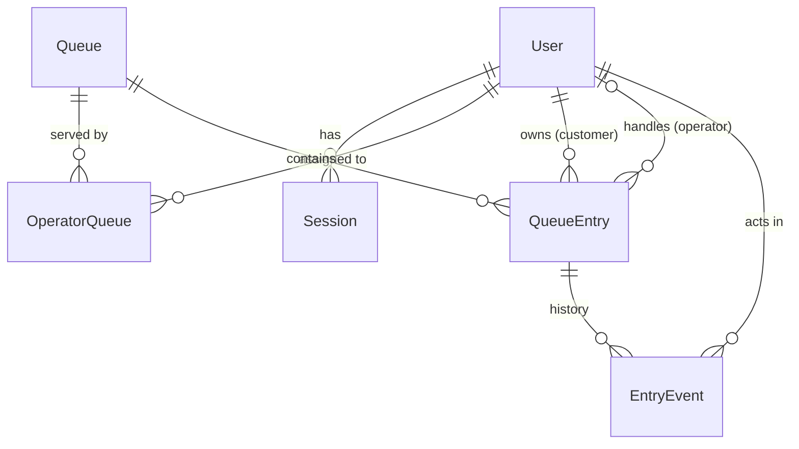
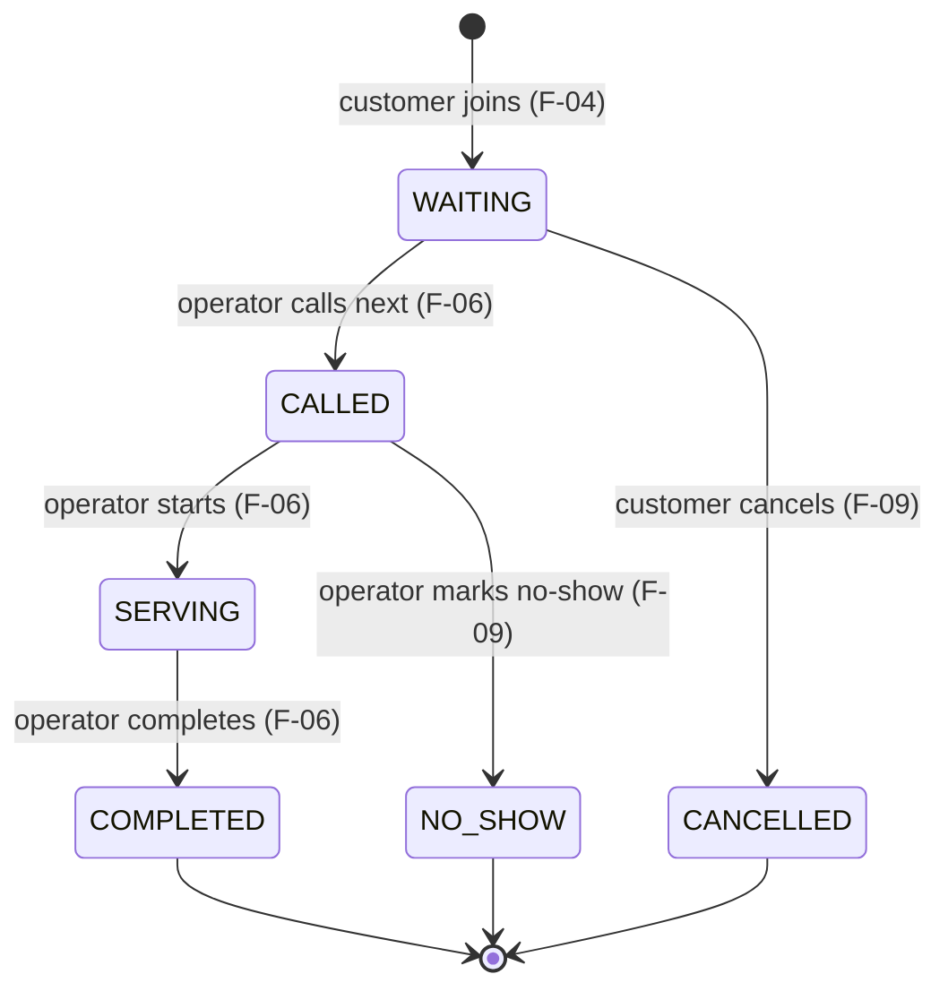

# System-Level Software Design Specification (SDS)

Queue and Service Management System, CPE 334 Theme 9.
Author: MacOverlorD (Lappawat Laohasoot), updated for Deliverable 2 by TauForge (Rattathamnoon Buranapattana). Reviewer: the other student for each change.
Version 0.4, 26 Nov 2026 (`v0.2.0` plus the Lab 7 change CR-01, *planned* until its code PR merges; contract `docs/maintenance/cr-01-queue-capacity.md`). Requirement IDs (FR, BR, NFR) refer to `docs/srs.md`; feature IDs to `docs/features.md`; decisions D-01 to D-14 to `CLAUDE.md` and D-15 to D-21 to `docs/srs.md` section 8.1.

**Status legend used in this document:** parts marked *(delivered)* are implemented on `main` at `v0.2.0-rc1`; parts marked *(planned)* are designed in a contract but not built (F-12 counters and priority, Sprint 3 hardening).

## 1. Purpose and scope

This document defines the architecture, data model, UI and API conventions, access control, configuration and planned deployment for the whole product. Feature-level details (exact request and response fields, AC, tests) live in the feature contracts under `docs/sprints/sprint-1/`, `sprint-2/` and `sprint-3/`. Where a contract is more specific, the contract wins and this document is updated in the same PR.

## 2. Architecture and stack

| Layer | Technology | Responsibility |
|---|---|---|
| UI | React + TypeScript + Vite (`client/`) | Screens and usability checks. Calls the API with the session cookie. Holds no authority: it never decides roles or ownership. |
| API / application | Node.js + Express + TypeScript (`server/`) | Authentication, authorization, input validation, business rules, state transitions, error mapping. |
| Persistence | PostgreSQL via Prisma | Durable storage and constraints that back the business rules (unique ticket number, one active entry per customer per queue). Migrations and seed. |
| Tests | Vitest + Supertest (unit, api, db, integration), Playwright (e2e) | Run against a real PostgreSQL test database (`queue_test`). No mock persistence. |

The product is a modular monolith: one API process and one database. In production the API also serves the built client, so the browser talks to a single origin.



### 2.1 Where rules are enforced

| Rule | Enforced in (feature) | Backed by the database |
|---|---|---|
| Valid session required, NFR-01 (401) | `requireAuth` (F-02, applied to all protected routes by F-03) | `Session` row with `expiresAt` |
| Role check, BR-09 (403 `FORBIDDEN_ROLE`) | `requireRole` (F-03) | `User.role` |
| Operator only on assigned queues, BR-06 (403 `FORBIDDEN_QUEUE`) | `requireQueueOperator` (F-03) | `OperatorQueue` |
| Customer sees only own entries, BR-07 (404) | entry queries filter by `customerId` (F-05) | `QueueEntry.customerId` |
| One active entry per customer per queue, BR-01 (409) | join service (F-04) | partial unique index (D-13) |
| Unique, increasing ticket numbers, BR-02, NFR-03 | join transaction (F-04, D-12) | `@@unique([queueId, number])` |
| Closed queue rejects joins, BR-10 (409) | join service (F-04) | `Queue.isOpen` in the same `UPDATE` |
| Full queue rejects joins, BR-15 (409 `QUEUE_FULL`, CR-01 *planned*) | join service (F-04): count of `WAITING` after the insert, rollback when over the limit | queue-row lock from the join `UPDATE`; check constraint 1..200 on `Queue.maxWaiting` |
| Head of line only, BR-03 | call-next service (F-06, D-07) | row lock on `Queue` |
| Allowed transitions only, BR-04, BR-11 (409) | conditional update on current status (F-06) | `UPDATE ... WHERE status = <expected>` |
| One called or serving entry per queue, BR-05 (409) | call-next service (F-06, D-08) | row lock on `Queue` (per counter by a partial unique index in F-12, *planned*) |
| Cancel only by the owner and only while waiting, BR-12 (404 / 409) | cancel service (F-09): lookup by `id` and `customerId`, conditional update | row lock on `Queue`, `UPDATE ... WHERE status = 'WAITING'` |
| No-show only on a called entry by an assigned operator, BR-13 (403 / 409) | `transition` with action `noShow` behind `operatorOnEntryParam` (F-09) | `UPDATE ... WHERE status = 'CALLED'` |
| Open and close only by an assigned operator, BR-09, BR-10 (403 / 400) | `PATCH /api/queues/:id` behind `operatorOnQueueParam`, body exactly `{ isOpen }`, or `{ maxWaiting }` for the limit (F-10, CR-01 *planned*) | `Queue.isOpen`, `Queue.maxWaiting` |
| Summary only for an assigned operator, day window in Bangkok time, D-19 (403 / 400) | summary service (F-13) reads `EntryEvent` | `EntryEvent.at`, `toStatus` |
| Public display has no private data, BR-08 | display service selects only safe fields (F-07) | none |

The UI may hide controls the user cannot use, but that is a convenience. Every rule above is checked on the server and covered by an api or db test.

### 2.2 Code layout (created by F-01)

```
client/                React + TypeScript + Vite
  src/pages/           Login, Queues, MyTicket (F-08a), OperatorConsole (F-08b, F-10), Display (F-11)
  src/api.ts           fetch wrapper: credentials "include", parses the error shape
server/
  prisma/              schema.prisma, migrations/, seed.ts
  src/app.ts           Express app without listen (imported by tests)
  src/index.ts         starts the server
  src/middleware/      requireAuth, requireRole, requireQueueOperator, validation, error handler
  src/routes/          auth, queues, entries, serve (operator, cancel, no-show, open/close), display, summary, access (route permission matrix)
  src/services/        business logic, one file per area (queues, serve, summary)
  tests/               unit, api, db, integration tests
e2e/                   Playwright journeys (customer, operator, cancel-no-show, queue-control, display)
docker-compose.yml     PostgreSQL for local development only
```

## 3. Data model

### 3.1 Entities

Field names follow the F-01 contract.

| Entity | Fields | Constraints and notes |
|---|---|---|
| `User` | `id`, `name`, `email`, `passwordHash`, `role` (`CUSTOMER` / `OPERATOR`) | `email` unique. `passwordHash` is bcrypt (cost 10 or more) and is never returned by the API (NFR-02). |
| `Session` | `id`, `userId`, `expiresAt` | `id` is a random 32-byte token (base64url). FK to `User` with cascade delete. Deleted on logout; an expired row is treated as absent and deleted when seen. |
| `Queue` | `id`, `name`, `serviceName`, `lastNumber` (default 0), `isOpen` (default true), `maxWaiting` (nullable, CR-01 *planned*) | `name` unique. `lastNumber` is the last ticket number handed out (SRS Q-02, resolved in the F-04 contract). `maxWaiting` is the waiting limit (BR-15): null means none, otherwise 1..200 by a database check; added by an additive migration, existing queues stay null. |
| `OperatorQueue` | `userId`, `queueId` | Composite primary key, both FK. Only `OPERATOR` users are linked (seed). |
| `QueueEntry` | `id`, `queueId`, `customerId`, `number`, `status`, `createdAt`, `calledAt`, `servingAt`, `completedAt`, `handledByOperatorId` | `status` is `WAITING`, `CALLED`, `SERVING`, `COMPLETED`, `CANCELLED` or `NO_SHOW` (the last two are reachable only from Sprint 2). `@@unique([queueId, number])`. Partial unique index on `(queueId, customerId)` where status is active (D-13). |
| `EntryEvent` | `id`, `entryId`, `fromStatus` (null for join), `toStatus`, `actorId`, `at` | Append-only history (FR-11), written in the same transaction as each status change. Source of the service summaries (FR-20, F-13, *delivered*). |

Active statuses are `WAITING`, `CALLED`, `SERVING`. Final statuses are `COMPLETED`, `CANCELLED`, `NO_SHOW` (BR-11). No schema change was made in Sprint 2 or for F-13: `CANCELLED`, `NO_SHOW` and `Queue.isOpen` existed from F-01.

#### Planned data changes (F-12, *planned*)

| Change | Detail |
|---|---|
| `Counter` | `id`, `queueId` (FK, cascade), `name`; `@@unique([queueId, name])`. Every existing queue gets "Counter 1" by the migration; Student Affairs is seeded with a second counter. |
| `QueueEntry.counterId` | Nullable FK, set when the entry is called. |
| Partial unique index | On `("counterId")` where status is `CALLED` or `SERVING`: BR-05 per counter, enforced by PostgreSQL (closes known gap G-02, answers SDS-Q1). |
| `QueueEntry.priority`, `priorityMarkedById` | Enum `NORMAL` / `PRIORITY` (default `NORMAL`) and the marking operator (F-12b, BR-14). |

The migration is additive and keeps every ticket number and status.

### 3.2 Relationships



Ownership: a `QueueEntry` belongs to exactly one customer (`customerId`). An operator's authority over a queue comes only from `OperatorQueue`.

### 3.3 Entry state machine



Sprint 1 had the first four arrows; Sprint 2 added cancel and no-show (F-09, *delivered*). The whole table lives in one pure function, `nextStatus(current, action)`, with the actions `start`, `complete`, `noShow` and `cancel`. Any other transition returns `409 INVALID_TRANSITION` and leaves the entry unchanged (BR-04, BR-11).

### 3.4 Concurrency design

- **Join (F-04, D-12):** one transaction runs `UPDATE "Queue" SET "lastNumber" = "lastNumber" + 1 WHERE id = $1 AND "isOpen" = true RETURNING "lastNumber"` and inserts the entry with the returned number. The `UPDATE` takes a row lock, so concurrent joins on the same queue get different, consecutive numbers (NFR-03). Zero rows means the queue is closed or missing. A duplicate active entry violates the partial unique index; the service maps that error to `409 DUPLICATE_ACTIVE_ENTRY` and the whole transaction rolls back, so the counter does not advance. Numbers are never reused (D-09). **CR-01 (*planned*):** the `UPDATE` also returns `maxWaiting`; after the insert, if it is set, the service counts the queue's `WAITING` entries and throws `409 QUEUE_FULL` when the count exceeds it, rolling back the entry, the event and the number. Because the lock is held and read committed sees every earlier committed join, the limit holds under concurrent joins (D-22).
- **Call next (F-06, D-07, D-08):** one transaction locks the queue row (`SELECT id FROM "Queue" WHERE id = $1 FOR UPDATE`), returns `409 QUEUE_BUSY` if an entry is `CALLED` or `SERVING`, picks the `WAITING` entry with the lowest number, sets it to `CALLED`, and writes an `EntryEvent`. The lock serializes concurrent call-next requests on one queue.
- **Cancel (F-09, D-15, D-16):** one transaction finds the entry by `id` and `customerId` (a missing or foreign entry is `404`), locks the same queue row that call-next locks, then runs `UPDATE ... SET status = 'CANCELLED' WHERE id = $1 AND "customerId" = $2 AND status = 'WAITING'` and writes the `EntryEvent`. Because both lock the queue row, a cancel and a call-next on the same entry cannot both succeed (tested for 10 rounds, TEST-F09-11).
- **No-show (F-09):** the same conditional update as start and complete, from `CALLED` to `NO_SHOW`; afterwards no entry is `CALLED` or `SERVING`, so the next call-next succeeds.
- **Open and close (F-10):** a single `UPDATE` of `Queue.isOpen`; entries are untouched. Setting the current value again is a no-op. Setting the waiting limit (CR-01) is a single `UPDATE` of `Queue.maxWaiting` on the same row, so it waits for an in-progress join.
- **Summary (F-13):** read-only; counts `EntryEvent` rows of one queue whose `at` lies in the Bangkok day, and averages (called time minus `QueueEntry.createdAt`) over the `CALLED` events of that day.
- **Start and complete (F-06):** `UPDATE "QueueEntry" SET status = <next>, <time column> = now() WHERE id = $1 AND status = <expected>`. Zero rows updated means the transition is not allowed (or a concurrent request already did it), so the API returns `409 INVALID_TRANSITION`.

### 3.5 Migrations and seed

- Schema changes go through `prisma migrate dev` (local) and `prisma migrate deploy` (test database, production).
- The D-13 partial index is raw SQL in the first migration (see the F-01 contract). Prisma does not track it, so every new migration file is checked for an accidental `DROP INDEX` before it is committed. TEST-F01-03 inserts a second active entry directly and expects a unique violation, so a missing index fails the suite.
- The seed is rerunnable without duplicates and creates 2 operators, 4 customers, 3 queues (one closed) and entries in every status across the queues, with at most one `CALLED` or `SERVING` entry per queue (BR-05; details in the F-01 contract). Passwords are dev-only demo values documented in the README and stored as bcrypt hashes.
- Data lives only in PostgreSQL; nothing is held in process memory between requests, so it survives an API restart (NFR-06).

## 4. UI structure and conventions

### 4.1 Screens and navigation

| Route | Who | Content | Feature |
|---|---|---|---|
| `/login` | anyone | Email and password form; after login, redirect by role | F-08a |
| `/queues` | customer | Queues with name, service, open/closed, waiting count (against the limit when set), Join button; **Full** with a disabled button at the limit (CR-01) | F-08a |
| `/my-ticket` | customer | Active entries with number, status, people ahead, **Cancel ticket** on a waiting entry; refreshes every 10 s | F-08a, F-09 |
| `/operator` | operator | Overview of every assigned queue (open/closed, waiting count, current entry, Open/Close and Select buttons, waiting limit input from CR-01), then the serve panel of the selected queue: current entry, waiting list, Call next, Start, Complete, **No-show**; the selected queue is kept in `?queue=<id>`; refreshes every 10 s | F-08b, F-09, F-10 |
| `/display/:queueId` | anyone (no login) | Queue name, open/closed, now serving number and status, waiting count, "Full" line when at the limit (CR-01), last update time; refreshes every 10 s; "Queue not found." and an error banner that keeps the last numbers | F-11 |
| header | logged-in users | User name, role, Log out | F-08a |

On load the client calls `GET /api/auth/me`. Without a session it goes to `/login`. A user on the other role's screen sees a "not available for your role" message. This is navigation only; the API still enforces every rule. Status updates use polling (NFR-08); WebSockets are out of scope.

### 4.2 Shared UI behavior

- **Validation:** required fields and email format are checked before submit. Server errors are still shown because the server is authoritative.
- **Loading:** an indicator is shown while data loads; action buttons are disabled while a request is in flight, which also prevents double submit.
- **Empty states:** for example "You are not in any queue", "No one is waiting".
- **Errors:** the API `error.message` is shown in a banner near the action. A `401` from any call returns the user to `/login`.

## 5. API conventions

- Base path `/api`. JSON bodies. The session travels in the `sid` cookie; the client sends `credentials: "include"`.
- Nouns for resources; action sub-paths for state transitions (`/call-next`, `/start`, `/complete`). `me` routes return only the caller's own data.
- Input is validated at the route boundary: path ids are positive integers and bodies have the expected fields and types. Invalid input returns `400 VALIDATION_ERROR` before any service runs.
- Success responses wrap the resource, for example `{ "entry": { ... } }` or `{ "entries": [ ... ] }`.
- Every error uses one shape and never includes stack traces, SQL, password hashes or other users' data:

```json
{ "error": { "code": "DUPLICATE_ACTIVE_ENTRY", "message": "You already have an active ticket in this queue." } }
```

| HTTP | Codes | When |
|---|---|---|
| 400 | `VALIDATION_ERROR` | Bad input shape or value |
| 401 | `UNAUTHENTICATED`, `INVALID_CREDENTIALS` | No or expired session; wrong email or password at login |
| 403 | `FORBIDDEN_ROLE`, `FORBIDDEN_QUEUE` | Wrong role; operator on a queue not assigned to them (unknown queue also 403 for operator routes) |
| 404 | `NOT_FOUND` | Missing resource, or a customer asks for another customer's entry (existence is not revealed) |
| 409 | `DUPLICATE_ACTIVE_ENTRY`, `QUEUE_CLOSED`, `QUEUE_BUSY`, `NO_WAITING_ENTRY`, `INVALID_TRANSITION` | Business-rule rejection; nothing is changed |
| planned | `COUNTER_BUSY` (replaces `QUEUE_BUSY`), `COUNTER_REQUIRED` (400), `TOO_MANY_ATTEMPTS` (429) | F-12 and hardening, not yet built |

Sprint 2 and F-13 added no new error code: cancel and no-show use `NOT_FOUND`, `FORBIDDEN_*` and `INVALID_TRANSITION`; the open/close body and the summary date use `VALIDATION_ERROR`.
| 500 | `INTERNAL_ERROR` | Unexpected error; details only in the server log |

### 5.1 Endpoint overview (details in each feature contract)

| Method and path | Access | Feature |
|---|---|---|
| `GET /api/health` | public | F-01 |
| `POST /api/auth/login` | public | F-02 |
| `POST /api/auth/logout` | logged in | F-02 |
| `GET /api/auth/me` | logged in | F-02 |
| `GET /api/queues` | customer | F-04 |
| `POST /api/queues/:id/entries` | customer | F-04 |
| `GET /api/me/entries`, `GET /api/me/entries/:id` | customer (own only) | F-05 |
| `GET /api/queues/:id/entries` | operator assigned to the queue | F-05 |
| `GET /api/operator/queues` | operator (returns assigned queues only) | F-06 |
| `POST /api/queues/:id/call-next` | operator assigned to the queue | F-06 |
| `POST /api/entries/:id/start`, `POST /api/entries/:id/complete` | operator assigned to the entry's queue | F-06 |
| `GET /api/queues/:id/display` | public | F-07 (used by the F-11 page) |
| `POST /api/me/entries/:id/cancel` | customer (own entry only, others 404) | F-09 |
| `POST /api/entries/:id/no-show` | operator assigned to the entry's queue | F-09 |
| `PATCH /api/queues/:id` | operator assigned to the queue; body `{ isOpen }` or `{ maxWaiting }` (CR-01) | F-10 |
| `GET /api/queues/:id/summary?date=YYYY-MM-DD` | operator assigned to the queue | F-13 |
| `POST /api/entries/:id/priority`; `call-next` with `counterId` | operator assigned (planned) | F-12 |

## 6. Roles and permissions

| Operation | Anonymous | Customer | Operator (assigned queue) | Operator (other queue) |
|---|---|---|---|---|
| Health, public display | yes | yes | yes | yes |
| Login | yes | yes | yes | yes |
| Logout, current user | 401 | yes | yes | yes |
| List queues, join queue | 401 | yes | 403 | 403 |
| View own entries | 401 | own only (others 404) | 403 | 403 |
| List assigned queues | 401 | 403 | yes (own assignments) | yes (own assignments) |
| View a queue's active entries | 401 | 403 | yes | 403 |
| Call next, start, complete | 401 | 403 | yes | 403 |
| Cancel an entry | 401 | own waiting entry only (others 404) | 403 | 403 |
| Mark no-show | 401 | 403 | yes (entry's queue) | 403 |
| Open or close a queue | 401 | 403 | yes | 403 |
| Read a service summary | 401 | 403 | yes | 403 |

The per-route matrix in the F-03 contract is the test source; each cell is covered by an api test.

## 7. Authentication and sessions (D-10)

- **Credentials:** email and password; bcrypt hashes with cost 10 or more. Plaintext passwords are never stored or logged.
- **Login:** lowercase and trim the input email, look up the user by exact match (emails are stored lowercase), and compare with bcrypt. Unknown email and wrong password return the same `401 INVALID_CREDENTIALS` message, so the response does not reveal which accounts exist.
- **Session creation:** insert a `Session` with a random 32-byte id and `expiresAt = now + SESSION_TTL_HOURS` (8). Set cookie `sid`: `HttpOnly`, `SameSite=Lax`, `Path=/`, `Max-Age` equal to the TTL, `Secure` when `NODE_ENV=production`.
- **Current user:** `requireAuth` reads `sid`, loads the session with its user, rejects a missing, unknown or expired session with `401 UNAUTHENTICATED` (deleting an expired row), and sets `req.user = { id, name, role }`. `GET /api/auth/me` returns `{ user: { id, name, email, role } }`.
- **Logout:** delete the `Session` row and clear the cookie. A later request with the old cookie gets `401` (NFR-05).
- **CSRF:** `SameSite=Lax` plus state changes only through `POST` with a JSON body, so cross-site form posts do not carry the session.

## 8. Configuration

| Variable | Purpose | Local example |
|---|---|---|
| `DATABASE_URL` | PostgreSQL connection for Prisma | see `.env.example` |
| `PORT` | API port | `3000` |
| `CLIENT_ORIGIN` | Browser origin allowed by CORS with credentials when the client runs on another origin | `http://localhost:5173` |
| `SESSION_TTL_HOURS` | Session lifetime | `8` |
| `NODE_ENV` | `production` enables the `Secure` cookie and hides error details | `development` |
| `VITE_REFRESH_MS` | Client refresh interval in tests (default 10 000 ms, NFR-08) | `1500` in the e2e suite |
| `LOGIN_MAX_ATTEMPTS`, `LOGIN_WINDOW_MINUTES` | Login rate limit (*planned*, hardening H-03; defaults 10 and 15) | - |
| `TEST_DATABASE_URL` | PostgreSQL connection used by the test suite (separate `queue_test` database) | see `.env.example` |
| `SEED_PASSWORD` | Dev-only demo password the seed hashes for every seeded account | see `.env.example` |

- In development the Vite dev server proxies `/api` to `http://localhost:3000`, so the cookie is first-party. `CLIENT_ORIGIN` is kept for setups without the proxy.
- Tests use a separate database (`TEST_DATABASE_URL`, `queue_test`). Every test file calls the shared `resetAndSeed()` helper (added in F-01) before it runs, so state changed by one file (for example F-04 joins in queue A) never leaks into another file's assertions.
- Every variable the server reads from `process.env` is listed in `.env.example` (TEST-F01-07).
- `.env.example` holds placeholders only; `.env` files are git-ignored (NFR-07). Production secrets are never in Git or client code.

## 9. Deployment (built in Lab 5, *delivered*)

| Component | Implementation |
|---|---|
| Container | One Docker image: the client is built and the server compiled; Express serves `/api` and the static client from one origin. Image tag is the full commit SHA. |
| Runtime | Cloud Run service `qms` (port 3000, 512 MiB, 1 CPU, 0 to 3 instances). |
| Database | Cloud SQL for PostgreSQL 16 (`qms-pg`); data survives restarts and new revisions (NFR-06). |
| Secrets | `DATABASE_URL` and the seed password in Secret Manager, injected as environment variables; never in Git. |
| Images | Artifact Registry repository `qms`. |
| Migrations | Cloud Run job `qms-migrate` runs `prisma migrate deploy` and the rerunnable seed before each service update. |
| Pipeline | GitHub Actions `CI & Docker Build` on pull requests (server tests on PostgreSQL 16, client build, Docker build). `Deploy demo` runs on every merge to `main`: build and push, migrate, update the service, then a smoke test of `/api/health` and `/`. |
| Revisions so far | `qms-00007-zqx` (Lab 6 baseline `253b80e`), `qms-00008-mg9` (`v0.2.0-sprint2`, `e82aaab`), `qms-00009-h99` (`v0.2.0-rc1`, `354f72d`). |

Because the migration job runs the seed on each deploy, the seed must stay rerunnable and must not reset data that users created. The planned F-12 migration is additive for the same reason. Details, setup and the environment-variable table are in `docs/labs/lab-05/deployment.md`.

### 9.1 Planned Sprint 3 design (*planned*, contracts only)

| Item | Design | Contract |
|---|---|---|
| Counters (FR-18) | `Counter` table, `counterId` on entries, BR-05 per counter by a partial unique index, call-next takes `counterId`; display shows each busy counter | F-12 (`sprint-3/f-12-counters-priority.md`) |
| Priority (FR-19, BR-14) | Operator-marked `PRIORITY`, priority first, at most 3 priority calls in a row; one pure `pickNext(waiting, recentCalls)` | F-12 |
| Security headers, CORS | One middleware for headers; no CORS in production unless `CLIENT_ORIGIN` is set | hardening H-01, H-02 |
| Login rate limit | Per email and client IP, in memory (per instance, so up to 3 instances on Cloud Run); `trust proxy` 1 so the key uses the real client IP | hardening H-03 |
| Session cleanup, coverage gate, performance check | Hourly purge started in `index.ts` only; 80% line gate in CI; `perf-check.ts` with p95 under 500 ms | hardening H-04..H-06 |

## 10. Open points for review

| ID | Question | Proposal |
|---|---|---|
| SDS-Q1 | Should BR-05 (one called or serving entry per queue) also be enforced by the database? | Decided in the F-12 contract: a partial unique index per counter (planned). Until it is built, the row lock is the only enforcement (gap G-02). |
| SDS-Q2 | Validation helper for the route boundary | Resolved: small hand-written checks in the routes (few fields). No library was added. |

## 11. Revision history

| Version | Date | Author | Change |
|---|---|---|---|
| 0.1 | 2026-11-05 | MacOverlorD | First draft, aligned with SRS v0.1 and the F-01, F-03, F-05, F-07, F-08a contracts |
| 0.2 | 2026-11-05 | MacOverlorD | Tau's review on #16: seed wording after BR-05 fix, per-file `resetAndSeed()`, `TEST_DATABASE_URL` and `SEED_PASSWORD`, lowercase email lookup |
| 0.3 | 2026-11-25 | TauForge | Deliverable 2: Sprint 2 and F-13 as built (rules, concurrency of cancel, endpoints, permission matrix, screens), planned F-12 data model and hardening marked *planned*, deployment section updated from Lab 5, SDS-Q1 and SDS-Q2 resolved |
| 0.4 | 2026-11-26 | TauForge | Lab 7 change CR-01 (#82): `Queue.maxWaiting`, BR-15 enforcement in the join transaction, PATCH body, screens; marked *planned* until the code PR merges |
