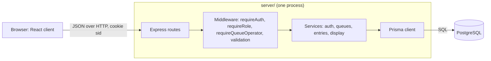
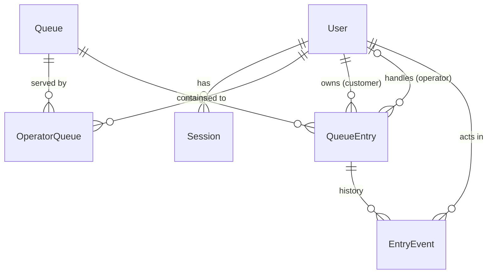
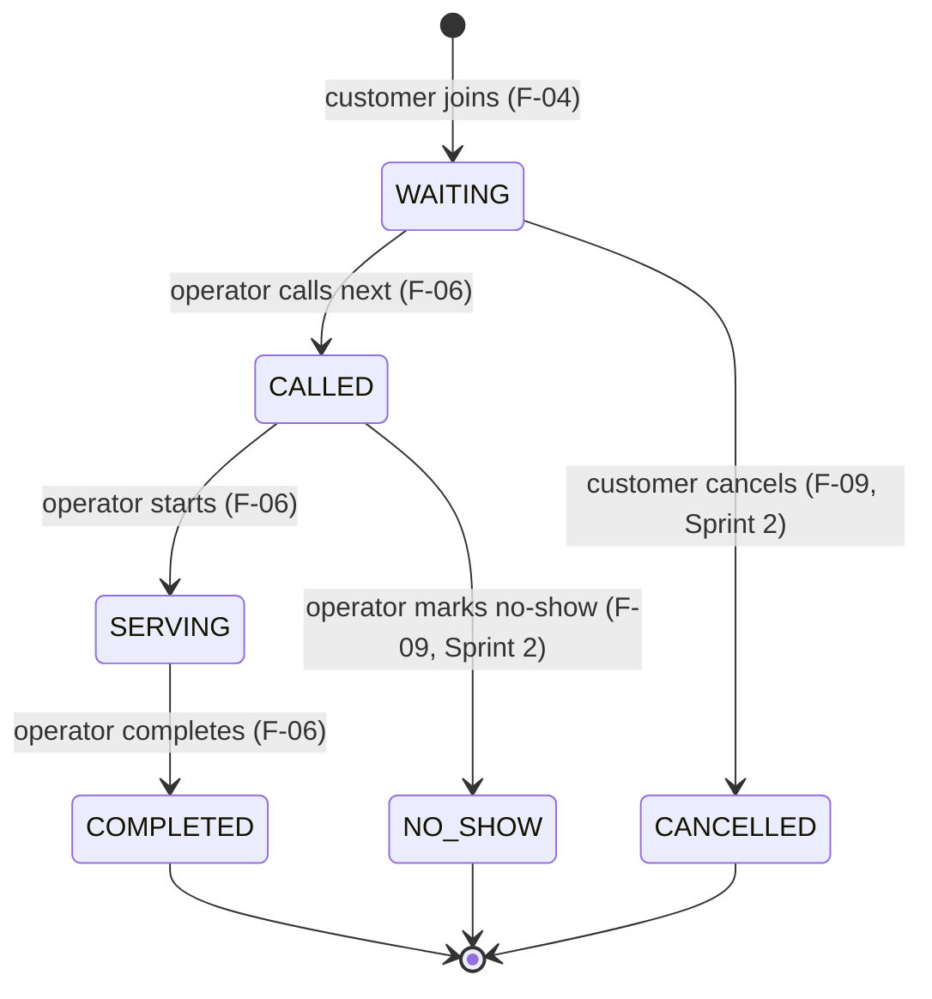

# System-Level Software Design Specification (SDS)

Queue and Service Management System, CPE 334 Theme 9.
Author: MacOverlorD (Lappawat Laohasoot). Reviewer: TauForge (Rattathamnoon Buranapattana).
Version 0.1, 5 Nov 2026. Requirement IDs (FR, BR, NFR) refer to `docs/srs.md`; feature IDs to `docs/features.md`; decisions D-01 to D-14 to `CLAUDE.md`.

## 1. Purpose and scope

This document defines the architecture, data model, UI and API conventions, access control, configuration and planned deployment for the whole product. Feature-level details (exact request and response fields, AC, tests) live in the feature contracts under `docs/sprints/sprint-1/`. Where a contract is more specific, the contract wins and this document is updated in the same PR.

## 2. Architecture and stack

| Layer | Technology | Responsibility |
|---|---|---|
| UI | React + TypeScript + Vite (`client/`) | Screens and usability checks. Calls the API with the session cookie. Holds no authority: it never decides roles or ownership. |
| API / application | Node.js + Express + TypeScript (`server/`) | Authentication, authorization, input validation, business rules, state transitions, error mapping. |
| Persistence | PostgreSQL via Prisma | Durable storage and constraints that back the business rules (unique ticket number, one active entry per customer per queue). Migrations and seed. |
| Tests | Vitest + Supertest (unit, api, db, integration), Playwright (e2e) | Run against a real PostgreSQL test database (`queue_test`). No mock persistence. |

The product is a modular monolith: one API process and one database. In production the API also serves the built client, so the browser talks to a single origin.



### 2.1 Where rules are enforced

| Rule | Enforced in (feature) | Backed by the database |
|---|---|---|
| Valid session required, NFR-01 (401) | `requireAuth` (F-02, applied to all protected routes by F-03) | `Session` row with `expiresAt` |
| Role check, BR-09 (403 `FORBIDDEN_ROLE`) | `requireRole` (F-03) | `User.role` |
| Operator only on assigned queues, BR-06 (403 `FORBIDDEN_QUEUE`) | `requireQueueOperator` (F-03) | `OperatorQueue` |
| Customer sees only own entries, BR-07 (404) | entry queries filter by `customerId` (F-05) | `QueueEntry.customerId` |
| One active entry per customer per queue, BR-01 (409) | join service (F-04) | partial unique index (D-13) |
| Unique, increasing ticket numbers, BR-02, NFR-03 | join transaction (F-04, D-12) | `@@unique([queueId, number])` |
| Closed queue rejects joins, BR-10 (409) | join service (F-04) | `Queue.isOpen` in the same `UPDATE` |
| Head of line only, BR-03 | call-next service (F-06, D-07) | row lock on `Queue` |
| Allowed transitions only, BR-04, BR-11 (409) | conditional update on current status (F-06) | `UPDATE ... WHERE status = <expected>` |
| One called or serving entry per queue, BR-05 (409) | call-next service (F-06, D-08) | row lock on `Queue` |
| Public display has no private data, BR-08 | display service selects only safe fields (F-07) | none |

The UI may hide controls the user cannot use, but that is a convenience. Every rule above is checked on the server and covered by an api or db test.

### 2.2 Code layout (created by F-01)

```
client/                React + TypeScript + Vite
  src/pages/           Login, Queues, MyTicket (F-08a), OperatorConsole (F-08b)
  src/api.ts           fetch wrapper: credentials "include", parses the error shape
server/
  prisma/              schema.prisma, migrations/, seed.ts
  src/app.ts           Express app without listen (imported by tests)
  src/index.ts         starts the server
  src/middleware/      requireAuth, requireRole, requireQueueOperator, validation, error handler
  src/routes/          auth, queues, entries, operator, display, health
  src/services/        business logic, one file per area
  tests/               unit, api, db, integration tests
e2e/                   Playwright journeys
docker-compose.yml     PostgreSQL for local development only
```

## 3. Data model

### 3.1 Entities

Field names follow the F-01 contract.

| Entity | Fields | Constraints and notes |
|---|---|---|
| `User` | `id`, `name`, `email`, `passwordHash`, `role` (`CUSTOMER` / `OPERATOR`) | `email` unique. `passwordHash` is bcrypt (cost 10 or more) and is never returned by the API (NFR-02). |
| `Session` | `id`, `userId`, `expiresAt` | `id` is a random 32-byte token (base64url). FK to `User` with cascade delete. Deleted on logout; an expired row is treated as absent and deleted when seen. |
| `Queue` | `id`, `name`, `serviceName`, `lastNumber` (default 0), `isOpen` (default true) | `name` unique. `lastNumber` is the last ticket number handed out (SRS Q-02, resolved in the F-04 contract). |
| `OperatorQueue` | `userId`, `queueId` | Composite primary key, both FK. Only `OPERATOR` users are linked (seed). |
| `QueueEntry` | `id`, `queueId`, `customerId`, `number`, `status`, `createdAt`, `calledAt`, `servingAt`, `completedAt`, `handledByOperatorId` | `status` is `WAITING`, `CALLED`, `SERVING`, `COMPLETED`, `CANCELLED` or `NO_SHOW` (the last two are reachable only from Sprint 2). `@@unique([queueId, number])`. Partial unique index on `(queueId, customerId)` where status is active (D-13). |
| `EntryEvent` | `id`, `entryId`, `fromStatus` (null for join), `toStatus`, `actorId`, `at` | Append-only history (FR-11), written in the same transaction as each status change. Source for Sprint 3 summaries (FR-20). |

Active statuses are `WAITING`, `CALLED`, `SERVING`. Final statuses are `COMPLETED`, `CANCELLED`, `NO_SHOW` (BR-11).

### 3.2 Relationships



Ownership: a `QueueEntry` belongs to exactly one customer (`customerId`). An operator's authority over a queue comes only from `OperatorQueue`.

### 3.3 Entry state machine



In Sprint 1 only the first four arrows exist. Any other transition returns `409 INVALID_TRANSITION` and leaves the entry unchanged (BR-04, BR-11).

### 3.4 Concurrency design

- **Join (F-04, D-12):** one transaction runs `UPDATE "Queue" SET "lastNumber" = "lastNumber" + 1 WHERE id = $1 AND "isOpen" = true RETURNING "lastNumber"` and inserts the entry with the returned number. The `UPDATE` takes a row lock, so concurrent joins on the same queue get different, consecutive numbers (NFR-03). Zero rows means the queue is closed or missing. A duplicate active entry violates the partial unique index; the service maps that error to `409 DUPLICATE_ACTIVE_ENTRY` and the whole transaction rolls back, so the counter does not advance. Numbers are never reused (D-09).
- **Call next (F-06, D-07, D-08):** one transaction locks the queue row (`SELECT id FROM "Queue" WHERE id = $1 FOR UPDATE`), returns `409 QUEUE_BUSY` if an entry is `CALLED` or `SERVING`, picks the `WAITING` entry with the lowest number, sets it to `CALLED`, and writes an `EntryEvent`. The lock serializes concurrent call-next requests on one queue.
- **Start and complete (F-06):** `UPDATE "QueueEntry" SET status = <next>, <time column> = now() WHERE id = $1 AND status = <expected>`. Zero rows updated means the transition is not allowed (or a concurrent request already did it), so the API returns `409 INVALID_TRANSITION`.

### 3.5 Migrations and seed

- Schema changes go through `prisma migrate dev` (local) and `prisma migrate deploy` (test database, production).
- The D-13 partial index is raw SQL in the first migration (see the F-01 contract). Prisma does not track it, so every new migration file is checked for an accidental `DROP INDEX` before it is committed. TEST-F01-03 inserts a second active entry directly and expects a unique violation, so a missing index fails the suite.
- The seed is rerunnable without duplicates and creates 2 operators, 4 customers, 3 queues (one closed) and entries in every status across the queues, with at most one `CALLED` or `SERVING` entry per queue (BR-05; details in the F-01 contract). Passwords are dev-only demo values documented in the README and stored as bcrypt hashes.
- Data lives only in PostgreSQL; nothing is held in process memory between requests, so it survives an API restart (NFR-06).

## 4. UI structure and conventions

### 4.1 Screens and navigation

| Route | Who | Content | Feature |
|---|---|---|---|
| `/login` | anyone | Email and password form; after login, redirect by role | F-08a |
| `/queues` | customer | Queues with name, service, open/closed, waiting count, Join button | F-08a |
| `/my-ticket` | customer | Active entries with number, status, people ahead; refreshes every 10 s | F-08a |
| `/operator` | operator | Assigned queue selector, current called/serving entry, waiting list, Call next, Start, Complete; refreshes every 10 s | F-08b |
| header | logged-in users | User name, role, Log out | F-08a |

On load the client calls `GET /api/auth/me`. Without a session it goes to `/login`. A user on the other role's screen sees a "not available for your role" message. This is navigation only; the API still enforces every rule. Status updates use polling (NFR-08); WebSockets are out of scope.

### 4.2 Shared UI behavior

- **Validation:** required fields and email format are checked before submit. Server errors are still shown because the server is authoritative.
- **Loading:** an indicator is shown while data loads; action buttons are disabled while a request is in flight, which also prevents double submit.
- **Empty states:** for example "You are not in any queue", "No one is waiting".
- **Errors:** the API `error.message` is shown in a banner near the action. A `401` from any call returns the user to `/login`.

## 5. API conventions

- Base path `/api`. JSON bodies. The session travels in the `sid` cookie; the client sends `credentials: "include"`.
- Nouns for resources; action sub-paths for state transitions (`/call-next`, `/start`, `/complete`). `me` routes return only the caller's own data.
- Input is validated at the route boundary: path ids are positive integers and bodies have the expected fields and types. Invalid input returns `400 VALIDATION_ERROR` before any service runs.
- Success responses wrap the resource, for example `{ "entry": { ... } }` or `{ "entries": [ ... ] }`.
- Every error uses one shape and never includes stack traces, SQL, password hashes or other users' data:

```json
{ "error": { "code": "DUPLICATE_ACTIVE_ENTRY", "message": "You already have an active ticket in this queue." } }
```

| HTTP | Codes | When |
|---|---|---|
| 400 | `VALIDATION_ERROR` | Bad input shape or value |
| 401 | `UNAUTHENTICATED`, `INVALID_CREDENTIALS` | No or expired session; wrong email or password at login |
| 403 | `FORBIDDEN_ROLE`, `FORBIDDEN_QUEUE` | Wrong role; operator on a queue not assigned to them (unknown queue also 403 for operator routes) |
| 404 | `NOT_FOUND` | Missing resource, or a customer asks for another customer's entry (existence is not revealed) |
| 409 | `DUPLICATE_ACTIVE_ENTRY`, `QUEUE_CLOSED`, `QUEUE_BUSY`, `NO_WAITING_ENTRY`, `INVALID_TRANSITION` | Business-rule rejection; nothing is changed |
| 500 | `INTERNAL_ERROR` | Unexpected error; details only in the server log |

### 5.1 Endpoint overview (details in each feature contract)

| Method and path | Access | Feature |
|---|---|---|
| `GET /api/health` | public | F-01 |
| `POST /api/auth/login` | public | F-02 |
| `POST /api/auth/logout` | logged in | F-02 |
| `GET /api/auth/me` | logged in | F-02 |
| `GET /api/queues` | customer | F-04 |
| `POST /api/queues/:id/entries` | customer | F-04 |
| `GET /api/me/entries`, `GET /api/me/entries/:id` | customer (own only) | F-05 |
| `GET /api/queues/:id/entries` | operator assigned to the queue | F-05 |
| `GET /api/operator/queues` | operator (returns assigned queues only) | F-06 |
| `POST /api/queues/:id/call-next` | operator assigned to the queue | F-06 |
| `POST /api/entries/:id/start`, `POST /api/entries/:id/complete` | operator assigned to the entry's queue | F-06 |
| `GET /api/queues/:id/display` | public | F-07 |

## 6. Roles and permissions

| Operation | Anonymous | Customer | Operator (assigned queue) | Operator (other queue) |
|---|---|---|---|---|
| Health, public display | yes | yes | yes | yes |
| Login | yes | yes | yes | yes |
| Logout, current user | 401 | yes | yes | yes |
| List queues, join queue | 401 | yes | 403 | 403 |
| View own entries | 401 | own only (others 404) | 403 | 403 |
| List assigned queues | 401 | 403 | yes (own assignments) | yes (own assignments) |
| View a queue's active entries | 401 | 403 | yes | 403 |
| Call next, start, complete | 401 | 403 | yes | 403 |

The per-route matrix in the F-03 contract is the test source; each cell is covered by an api test.

## 7. Authentication and sessions (D-10)

- **Credentials:** email and password; bcrypt hashes with cost 10 or more. Plaintext passwords are never stored or logged.
- **Login:** lowercase and trim the input email, look up the user by exact match (emails are stored lowercase), and compare with bcrypt. Unknown email and wrong password return the same `401 INVALID_CREDENTIALS` message, so the response does not reveal which accounts exist.
- **Session creation:** insert a `Session` with a random 32-byte id and `expiresAt = now + SESSION_TTL_HOURS` (8). Set cookie `sid`: `HttpOnly`, `SameSite=Lax`, `Path=/`, `Max-Age` equal to the TTL, `Secure` when `NODE_ENV=production`.
- **Current user:** `requireAuth` reads `sid`, loads the session with its user, rejects a missing, unknown or expired session with `401 UNAUTHENTICATED` (deleting an expired row), and sets `req.user = { id, name, role }`. `GET /api/auth/me` returns `{ user: { id, name, email, role } }`.
- **Logout:** delete the `Session` row and clear the cookie. A later request with the old cookie gets `401` (NFR-05).
- **CSRF:** `SameSite=Lax` plus state changes only through `POST` with a JSON body, so cross-site form posts do not carry the session.

## 8. Configuration

| Variable | Purpose | Local example |
|---|---|---|
| `DATABASE_URL` | PostgreSQL connection for Prisma | see `.env.example` |
| `PORT` | API port | `3000` |
| `CLIENT_ORIGIN` | Browser origin allowed by CORS with credentials when the client runs on another origin | `http://localhost:5173` |
| `SESSION_TTL_HOURS` | Session lifetime | `8` |
| `NODE_ENV` | `production` enables the `Secure` cookie and hides error details | `development` |
| `TEST_DATABASE_URL` | PostgreSQL connection used by the test suite (separate `queue_test` database) | see `.env.example` |
| `SEED_PASSWORD` | Dev-only demo password the seed hashes for every seeded account | see `.env.example` |

- In development the Vite dev server proxies `/api` to `http://localhost:3000`, so the cookie is first-party. `CLIENT_ORIGIN` is kept for setups without the proxy.
- Tests use a separate database (`TEST_DATABASE_URL`, `queue_test`). Every test file calls the shared `resetAndSeed()` helper (added in F-01) before it runs, so state changed by one file (for example F-04 joins in queue A) never leaks into another file's assertions.
- Every variable the server reads from `process.env` is listed in `.env.example` (TEST-F01-07).
- `.env.example` holds placeholders only; `.env` files are git-ignored (NFR-07). Production secrets are never in Git or client code.

## 9. Planned deployment (built in Lab 5)

| Component | Plan |
|---|---|
| Container | One Docker image: build the client, compile the server; Express serves `/api` and the static client. |
| Runtime | Google Cloud Run service running the image. |
| Database | Cloud SQL for PostgreSQL; data survives container restarts and redeployments (NFR-06). |
| Secrets | `DATABASE_URL` in Secret Manager, injected as an environment variable. |
| Images | Artifact Registry. |
| Migrations | `prisma migrate deploy` runs as a release step before the new revision takes traffic. |
| Pipeline | GitHub Actions: build and tests on every PR as a required check; deploy from `main` after a reviewed merge. |

Docker and CI are not built for Deliverable 1. The design keeps the app container-ready: configuration comes only from environment variables, and no state is kept on the local filesystem.

## 10. Open points for review

| ID | Question | Proposal |
|---|---|---|
| SDS-Q1 | Should BR-05 (one called or serving entry per queue) also be enforced by the database? | Optional second partial unique index on `("queueId")` where status in (`CALLED`, `SERVING`). Not required for Sprint 1 because the row lock already serializes call-next; revisit in F-12. |
| SDS-Q2 | Validation helper for the route boundary | Small hand-written checks in `middleware/validation.ts` for Sprint 1 (few fields). Adopt a library only if both students agree, then record it as a decision. |

## 11. Revision history

| Version | Date | Author | Change |
|---|---|---|---|
| 0.1 | 2026-11-05 | MacOverlorD | First draft, aligned with SRS v0.1 and the F-01, F-03, F-05, F-07, F-08a contracts |
| 0.2 | 2026-11-05 | MacOverlorD | Tau's review on #16: seed wording after BR-05 fix, per-file `resetAndSeed()`, `TEST_DATABASE_URL` and `SEED_PASSWORD`, lowercase email lookup |
